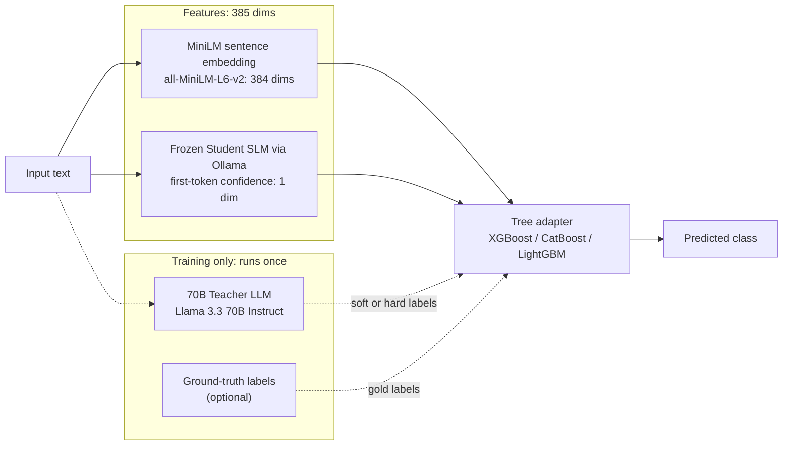

# TeasCo-FT · Tree Adapters

An implementation and simulation of the **TeasCo-FT** teacher–student cascade in which the only trainable part is a **gradient-boosted tree ensemble** (XGBoost, CatBoost or LightGBM). It has no MLP head and does no fine-tuning of the language models.

It classifies text, for example software requirements as *security-related* vs *not*, and comes with a Streamlit app, a command-line benchmark, an offline simulation of the training rules, and a notebook.



Solid arrows run at inference time. Dotted arrows are used only while training.

At inference time only the small local models run: MiniLM, the Student SLM and the trained trees. The 70B Teacher is called once, at training time, to label the training set.

---

## How it works

1. **Features.** Every text becomes a 385-dim vector: a 384-dim `all-MiniLM-L6-v2` sentence embedding plus the frozen Student SLM's confidence. The confidence is read from the probability of the Student's **first generated token**, asked in both option orders and averaged, which cancels small models' bias toward the first option. A number the model states about itself is not used.
2. **Teacher.** A 70B Teacher (Llama 3.3 70B Instruct by default) labels the training texts once and returns a probability distribution per text. It labels in batches of 25 and caches each result, so re-runs are free. Failed texts are dropped, never silently labelled, and a run stops if more than 5% fail.
3. **Supervision signals.** Each adapter can learn from **ground truth**, **Teacher pseudo-labels** (argmax), or **Teacher soft labels** (knowledge distillation). The trees get soft labels through *row expansion*: one weighted copy of each row per class. This is equivalent to cross-entropy against the Teacher's distribution.
4. **Gated update rule ("learn only from mistakes").** Rows the model already gets right are silenced, in one of three ways:

   | Gate mode | Mechanism | Adapters |
   |---|---|---|
   | `objective` | Custom loss that zeroes the gradient of confidently-correct rows, re-checked every round | XGBoost |
   | `staged` | Trees added in blocks of 25; already-correct rows are down-weighted to the *gate floor* before each block | all |
   | `none` | Plain boosting (control) | all |

   ```mermaid
   flowchart TD
       R["Training row"] --> Q{"Predicted correctly<br/>and confidently?<br/>(gate margin 0.10)"}
       Q -- "No: a mistake" --> F["Full weight<br/>new trees learn from it"]
       Q -- "Yes" --> G{"Gate mode"}
       G -- "objective (XGBoost)" --> Z["Gradient set to zero"]
       G -- "staged (all adapters)" --> W["Weight lowered to<br/>gate floor 0.10"]
       G -- "none (control)" --> F
   ```

   A **gate margin of 0.10** and a **gate floor of 0.10** keep the gate from collapsing a class or making validation F1 swing between stages (see [Simulation results](#simulation-results)).

5. **Diagnostics.** Every result is shown next to a majority-class baseline and the Student's zero-shot score. The app warns automatically about a constant Student confidence, a single-label Teacher, and collapsed models.

The full write-up is in [`docs/how_it_works.md`](docs/how_it_works.md). The app shows the same text in its **ℹ️ How it works** tab.

---

## Repository layout

```
app.py                        Streamlit front end (Data · Train · Results · Predict · How it works)
teasco_tree/
  _compat.py                  OpenMP load-order fix for torch + XGBoost/LightGBM on macOS
  data.py                     Dataset loading, cleaning, column guessing, bundled samples
  pipeline.py                 End-to-end experiment runner, run saving/loading
  plots.py                    Heatmaps, bar charts, training curves, confusion matrices
  system.py                   .env loading, Ollama model discovery, memory checks
  adapters/                   Tree adapters + gated objective (XGBoost, CatBoost, LightGBM)
  features/                   Embedders (MiniLM / hashing) and cached feature builder
  llm/                        Ollama Student, OpenAI-compatible Teacher, mock models
scripts/
  run_benchmark.py            The full cascade from the command line
  simulate_gate_modes.py      Offline simulations of gate modes and distillation signals
tests/                        pytest suite for the Teacher client and Ollama Student
data/                         Cleaned PROMISE, SecReq and NFR-SO datasets
results/                      Simulation outputs (JSON + PNG)
runs/                         Example saved runs (models, predictions, plots, results.json)
docs/how_it_works.md          Detailed method description
TeasCo_FT_TreeAdapters.ipynb  Notebook walkthrough
```

---

## Installation

Developed on Python 3.13.

```bash
pip install numpy pandas scikit-learn matplotlib \
            xgboost catboost lightgbm \
            sentence-transformers openai requests python-dotenv tqdm \
            streamlit pytest
```

For real (non-demo) runs you also need:

- **[Ollama](https://ollama.com)** running locally with a small Student model, e.g. `ollama pull qwen2.5:0.5b`
- **A Teacher API key.** The default preset uses Llama 3.3 70B on OpenRouter. Put the key in a `.env` file at the repo root:

  ```
  OPENROUTER_API_KEY=sk-or-...
  ```

  The key is read from the environment or `.env` and is never written to disk. A ~800-text training set costs about one US cent to label. A local `ollama-llama3.3-70b` Teacher preset is also available.

> **macOS note:** always `import teasco_tree` before anything that imports `torch`. PyTorch, XGBoost and LightGBM each ship their own OpenMP runtime, and if torch's loads first the boosting libraries abort the process at training time. The package handles this as long as it is imported first (see `teasco_tree/_compat.py`).

---

## Usage

### Streamlit app

```bash
streamlit run app.py
```

1. **📂 Data:** upload a CSV/XLSX or pick a bundled sample, then choose the text and label columns. The label column is optional: with no labels, the Teacher labels the data.
2. **🚀 Train:** pick adapters, supervision signals and boosting/gate settings, then train.
3. **📊 Results:** macro-F1 tables, heatmap, bar charts, training curves and confusion matrices.
4. **🔮 Predict:** reload any saved run and classify new text.

Turn on **Offline demo** in the sidebar to run the whole flow in seconds with no Ollama, API key or downloads. It uses keyword-based mock models and a hashing embedder, so **its scores mean nothing**.

### Command-line benchmark

```bash
# PROMISE -> held-out split + SecReq + NFR-SO, qwen2.5:0.5b Student, Llama 3.3 70B Teacher
python scripts/run_benchmark.py

# your own data
python scripts/run_benchmark.py --train my.csv --text-col sentence --label-col category \
    --test other.csv --test-text-col sentence --test-label-col category

# mock models, no network (numbers are meaningless)
python scripts/run_benchmark.py --offline
```

Useful flags: `--student`, `--teacher-preset`, `--adapters xgboost,catboost,lightgbm`, `--supervisions ground_truth,teacher_hard,teacher_soft`, `--n-estimators`, `--holdout`, `--seed`. Run `python scripts/run_benchmark.py -h` for the full list.

### Offline simulation

```bash
python scripts/simulate_gate_modes.py              # 3 seeds
python scripts/simulate_gate_modes.py --seeds 1    # quick look
```

This runs on synthetic 385-dim features that mimic the real feature matrix, needs no LLM, API key or downloads, and writes `results/simulation_*.json` and `results/simulation_*.png`.

### Tests

```bash
pytest
```

---

## Datasets

| File | Contents |
|---|---|
| `data/PROMISE_exp_clean.csv` | 969 software requirements from 47 projects; 13% security-related |
| `data/secreq_clean.csv` | SecReq: 444 requirements from three security-focused specifications (CPN, GPS, ePurse) |
| `data/NFR_SO_clean.csv` | NFR-SO: 400-row sample of non-functional requirements |

---

## Simulation results

Mean test macro F1 over 3 seeds, 300 trees, from `results/simulation_gate_modes.json`.

| Configuration | Binary, balanced | Binary, 13% minority | 4-class, skewed |
|---|---|---|---|
| XGBoost · objective gate (margin 0.1) | 0.905 | 0.869 | 0.777 |
| XGBoost · objective gate, **margin 0** | **0.341** | **0.464** | 0.714 |
| XGBoost · staged, floor 0.1 | 0.957 | 0.929 | 0.831 |
| XGBoost · ungated | 0.955 | 0.932 | 0.841 |
| CatBoost · staged, floor 0.1 | 0.952 | 0.908 | 0.840 |
| CatBoost · ungated | 0.957 | 0.920 | 0.837 |
| LightGBM · staged, floor 0.1 | 0.955 | 0.935 | 0.833 |
| LightGBM · ungated | 0.959 | 0.941 | 0.839 |

Takeaways:

- **The gate margin is essential.** Without it, the objective gate silences a whole class in the first boosting round and the model collapses (F1 ≈ 0.34 on balanced binary data).
- **The gate floor stabilises training.** A floor of 0 makes validation F1 swing between stages. The mean swing for CatBoost is 0.447 at floor 0 and 0.026 at floor 0.1.
- **Distillation helps more often than not.** In `results/simulation_distillation.json`, training on a noisy Teacher's labels (hard or soft) matches or beats gold labels in most scenario/adapter pairs. For example, XGBoost on 4-class data scores 0.777 with ground truth, 0.825 with Teacher hard labels and 0.820 with soft labels.

The plots are in `results/simulation_gate_modes.png`, `results/simulation_gate_stability.png` and `results/simulation_distillation.png`.

> The two example runs under `runs/` were produced in **offline demo mode** (mock Student and Teacher, hashing embedder). They show the saved-run format and work with the Predict tab, but their scores do not reflect real model performance.

---

## Saved runs

Each run is saved to `runs/<timestamp>_<name>/`:

- `results.json`: scores, diagnostics and settings (never the API key)
- `predictions/`: one CSV per test set
- `models/`: every trained model plus `manifest.json`
- `plots/`: every chart as PNG

To use a saved run in the **🔮 Predict** tab, the same Student model must be available in Ollama, since features are rebuilt the same way.
