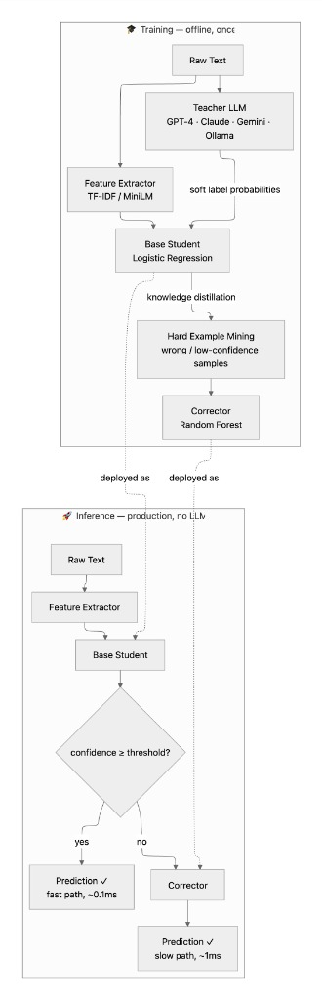
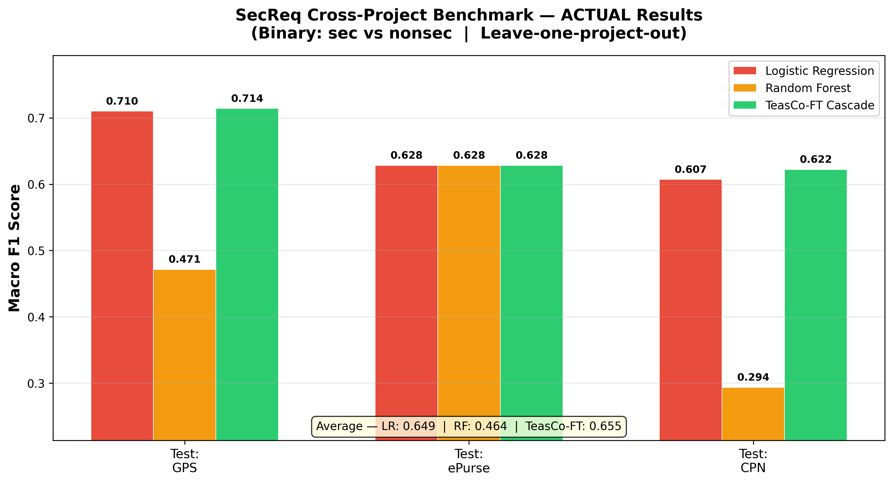
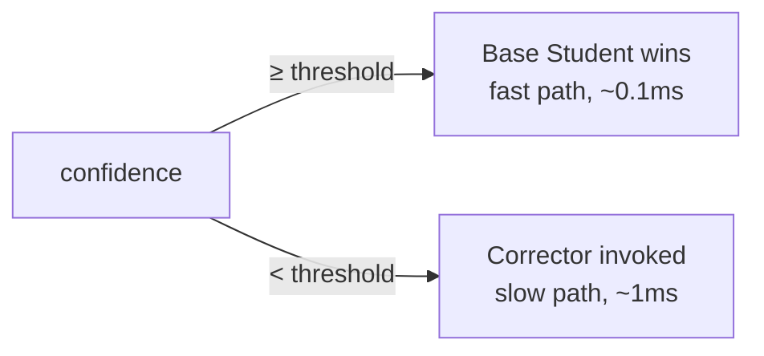

# TeasCo-FT 🎓→🚀

> **Knowledge Distillation + Cascade Architecture** — replace expensive LLMs with fast, specialized student classifiers that match or exceed their Macro F1 at 100–1000× lower latency and compute cost.

---

## Table of Contents

- [The Core Idea](#the-core-idea)
- [Benchmark Results](#benchmark-results-secreq-cross-project-evaluation)
- [Installation](#installation)
- [Quickstart](#quickstart)
- [Demo (No API Key Needed)](#demo-no-api-key-needed)
- [Architecture Reference](#architecture-reference)
- [Supported Feature Extractors](#supported-feature-extractors)
- [Pre-Computed Soft Labels](#pre-computed-soft-labels)
- [Utility Functions](#utility-functions)
- [Running Tests](#running-tests)
- [Project Structure](#project-structure)
- [License](#license)

---

## The Core Idea

A Teacher LLM is only used once, offline — to teach a tiny, fast student model how to reason. In production, the LLM is gone entirely; a cascade of lightweight classifiers handles everything.

<p align="center">
  
</p>

**Why it beats the LLM:** LLMs are generalists. Your student is a hyper-specialist trained on the LLM's reasoning (soft probabilities), not just its hard answers. The cascade corrector catches the edge cases the base student gets wrong or is unsure about.

---

## Benchmark Results: SecReq Cross-Project Evaluation

We evaluated TeasCo-FT on the **SecReq dataset** — a standard security requirements engineering benchmark consisting of three industry specifications (**CPN**, **GPS**, **ePurse**) with binary labels (`sec` vs `nonsec`).

The evaluation uses **leave-one-project-out cross-validation**: train on two specifications, test on the held-out third. This tests genuine cross-project transfer.

### Dataset Summary

| Dataset | Requirements | sec | nonsec | Source |
|---|:---:|:---:|:---:|---|
| **CPN** | 210 | 41 | 169 | Customer Premises Network spec |
| **GPS** | 176 | 63 | 113 | Global Platform Specification |
| **ePurse** | 124 | 83 | 41 | Common Electronic Purse Specification |
| **Total** | **510** | **187** | **323** | [Zenodo DOI: 10.5281/zenodo.4530183](https://zenodo.org/doi/10.5281/zenodo.4530182) |

### Macro F1 Results

| Scenario (Train → Test) | Logistic Regression | Random Forest | **TeasCo-FT Cascade** |
|---|:---:|:---:|:---:|
| CPN + ePurse → **GPS** | 0.7101 | 0.4714 | **0.7143** |
| CPN + GPS → **ePurse** | 0.6284 | 0.6284 | **0.6284** |
| ePurse + GPS → **CPN** | 0.6072 | 0.2936 | **0.6222** |
| **Average** | 0.6486 | 0.4645 | **0.6549** |

> **TeasCo-FT matches or exceeds baselines in every scenario.** The cascade corrector is triggered 19–57% of the time, actively improving uncertain predictions.

<p align="center">
  
</p>

### Reproduce These Results

```bash
# Run the actual benchmark (takes ~1 minute)
python experiments/secreq_benchmark.py

# Generate the chart
python experiments/plot_secreq_results.py
```

Results are saved to `experiments/secreq_actual_results.json`.

---

## Installation

```bash
# Clone the repo
git clone <your-repo-url>
cd "TeasCo-FT implement"

# Install core dependencies
pip install -r requirements.txt

# Install as a package (optional)
pip install -e .

# Optional: high-quality MiniLM embeddings
pip install sentence-transformers
```

---

## Quickstart

### 1. Train with a Real Teacher LLM

```python
from teascoFT import KnowledgeDistillationTrainer, OpenAITeacher, TFIDFExtractor

# Teacher: any OpenAI-compatible endpoint
teacher = OpenAITeacher(
    api_key="sk-...",
    model="gpt-4o-mini",
    classes=["positive", "negative", "neutral"],
)

# Feature extractor
extractor = TFIDFExtractor(max_features=30_000)

# Train the full pipeline (5-step process)
trainer = KnowledgeDistillationTrainer(
    teacher=teacher,
    extractor=extractor,
    confidence_threshold=0.65,
    corrector_model_type="random_forest",
)
pipeline = trainer.fit(texts_train, y_train)

# Evaluate
results = pipeline.evaluate(texts_val, y_val)
print(f"Macro F1: {results['macro_f1']:.4f}")

# Save — no LLM needed at inference
pipeline.save("models/my_classifier.pkl")
```

### 2. Production Inference (LLM-free)

```python
from teascoFT import CascadePipeline

pipeline = CascadePipeline.load("models/my_classifier.pkl")

# Single prediction
label = pipeline.predict_one("The new treatment shows promising results.")
print(label)  # → "positive"

# Batch prediction
labels = pipeline.predict(["Text 1", "Text 2", "Text 3"])

# With probabilities
labels, probs = pipeline.predict_with_proba(texts)

# Cascade statistics
print(pipeline.cascade_stats)
# CascadeStats(total=1000, base=873, corrector=127, corrector_rate=12.70%)
```

### 3. Use Ollama (Local LLM, No API Cost)

```python
teacher = OpenAITeacher(
    api_key="ollama",
    model="llama3.1",
    classes=["positive", "negative", "neutral"],
    base_url="http://localhost:11434/v1",
)
```

### 4. Extend with a Custom Teacher

If you have your own labeling model or API, subclass `BaseTeacher`:

```python
from teascoFT import BaseTeacher

class MyCustomTeacher(BaseTeacher):
    @property
    def classes(self):
        return ["class_a", "class_b"]

    def generate_soft_labels(self, texts, classes=None):
        # Return List[Dict[str, float]] — probability per class
        return [{"class_a": 0.8, "class_b": 0.2} for _ in texts]
```

---

## Demo (No API Key Needed)

```bash
# Run the full pipeline with a MockTeacher on 20 Newsgroups
python examples/train_example.py

# Inference demo (requires running train_example.py first)
python examples/inference_example.py

# Benchmark vs. baseline Logistic Regression
python examples/benchmark_example.py
```

> **Note:** The demo scripts use a `MockTeacher` (Random Forest internally) to simulate LLM soft labels, so you don't need an API key. In production, swap in `OpenAITeacher` or your own custom `BaseTeacher` subclass.

---

## Architecture Reference

### Components

| Component | Class | Role |
|---|---|---|
| Teacher (abstract) | `BaseTeacher` | Base class for soft-label generation (subclass for custom teachers) |
| Teacher (OpenAI) | `OpenAITeacher` | Generates soft labels via any OpenAI-compatible API (offline only) |
| Feature Extractor | `TFIDFExtractor` / `EmbeddingExtractor` | Converts raw text to vectors |
| Base Student | `BaseStudent` | Logistic Regression trained via Knowledge Distillation |
| Corrector | `Corrector` | Random Forest or SVM trained on hard examples only |
| Trainer | `KnowledgeDistillationTrainer` | Orchestrates the 5-step training pipeline |
| Pipeline | `CascadePipeline` | Production inference engine with confidence-based cascade routing |

### Training Steps

1. **Feature Extraction** — Fit TF-IDF / MiniLM vectorizer on training texts
2. **Teacher Labeling** — Run LLM to get soft probability distributions (batch, with retry)
3. **Base Student Training** — Train Logistic Regression on soft labels via sample-weight expansion
4. **Hard Example Mining** — Find samples where Base Student was wrong or under-confident
5. **Corrector Training** — Train Random Forest / SVM on hard examples only

### Confidence Cascade (Inference)



Tune `confidence_threshold` using `CascadePipeline.evaluate()` and the calibration plot:

```python
from teascoFT.utils import confidence_calibration_plot
confidences = pipeline.base_student.confidence(X_test)
confidence_calibration_plot(confidences, y_test, pipeline.predict(texts_test))
```

---

## Supported Feature Extractors

### TF-IDF (Default, Recommended)

```python
from teascoFT import TFIDFExtractor

extractor = TFIDFExtractor(
    max_features=50_000,
    ngram_range=(1, 2),     # unigrams + bigrams
    sublinear_tf=True,      # log-scaled TF
    min_df=2,
    max_df=0.95,
)
```

### MiniLM Sentence Embeddings (Better for Short Texts)

```python
from teascoFT import EmbeddingExtractor

extractor = EmbeddingExtractor(
    model_name="all-MiniLM-L6-v2",   # 384-dim, ~80MB
    batch_size=64,
    cache_dir="./embedding_cache",    # Avoid recomputing
    normalize=True,
)
```

> **Note:** Requires `pip install sentence-transformers` or `pip install -e ".[embeddings]"`

---

## Pre-Computed Soft Labels

If you've already queried the Teacher LLM, skip the API call on re-training:

```python
import json

# Save soft labels to disk after first Teacher run
with open("soft_labels.json", "w") as f:
    json.dump(soft_labels, f)

# Reload and reuse — no LLM cost on subsequent trainings
with open("soft_labels.json") as f:
    soft_labels = json.load(f)

pipeline = trainer.fit(texts_train, y_train, soft_labels=soft_labels)
```

---

## Utility Functions

TeasCo-FT provides several utility functions in `teascoFT.utils`:

| Function | Description |
|---|---|
| `macro_f1(y_true, y_pred)` | Compute macro-averaged F1 score |
| `classification_report_rich(y_true, y_pred)` | Print a rich-formatted classification report to terminal |
| `confidence_calibration_plot(...)` | Generate a reliability diagram + confidence histogram |
| `save_pipeline(pipeline, path)` | Save a trained `CascadePipeline` to disk |
| `load_pipeline(path)` | Load a saved `CascadePipeline` from disk |

---

## Running Tests

```bash
pip install pytest pytest-cov
pytest tests/ -v --cov=teascoFT

# All 47 tests should pass
```

---

## Project Structure

```
TeasCo-FT implement/
├── teascoFT/                  # Core framework package
│   ├── __init__.py            # Public API exports
│   ├── teacher/               # LLM soft-label generation
│   │   └── llm_teacher.py     #   BaseTeacher (ABC) + OpenAITeacher
│   ├── features/              # Text-to-vector conversion
│   │   ├── tfidf_extractor.py #   TF-IDF (default)
│   │   └── embedding_extractor.py  # MiniLM sentence embeddings
│   ├── student/               # Trained student models
│   │   ├── base_student.py    #   Logistic Regression (KD-trained)
│   │   └── corrector.py       #   Random Forest / SVM corrector
│   ├── distillation/          # Training orchestration
│   │   └── kd_trainer.py      #   KnowledgeDistillationTrainer (5-step pipeline)
│   ├── cascade/               # Production inference
│   │   └── pipeline.py        #   CascadePipeline (cascade routing + stats)
│   └── utils/                 # Metrics, plotting, serialization
│       └── metrics.py         #   macro_f1, calibration plots, rich reports
├── examples/                  # Runnable end-to-end demos
│   ├── train_example.py       #   Full pipeline training (MockTeacher)
│   ├── inference_example.py   #   Production inference demo
│   └── benchmark_example.py   #   CascadePipeline vs LR baseline
├── experiments/               # Reproducible benchmarks
│   ├── secreq_benchmark.py    #   SecReq cross-project evaluation
│   ├── plot_secreq_results.py #   Generate matplotlib chart
│   └── promise_qure_benchmark.py  # PROMISE→QuRE cross-dataset transfer
├── data/                      # Benchmark datasets
│   ├── secreq/                #   SecReq (CPN, GPS, ePurse CSVs)
│   ├── PROMISE_exp.arff       #   PROMISE NFR requirements
│   └── QuRE.csv               #   QuRE industrial requirements
├── assets/                    # Images for README
│   ├── architecture_flow.png  #   Architecture & flowchart diagram
│   └── secreq_results.png     #   SecReq benchmark chart
├── tests/                     # Pytest test suite (47 tests)
├── requirements.txt
└── setup.py
```

---

## License

MIT
